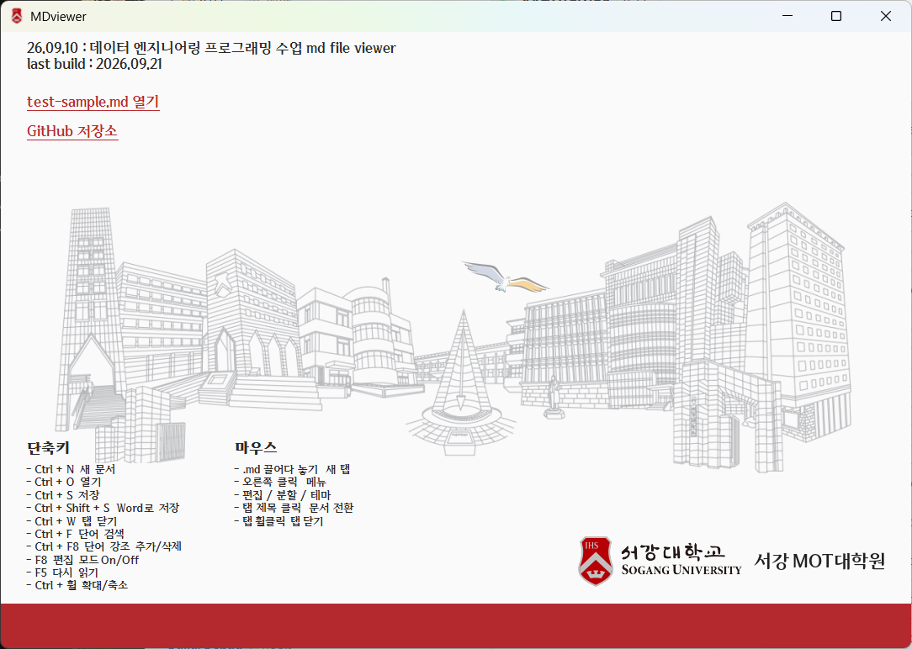

# MDviewer

서강대학교 MOT대학원 데이터 엔지니어링 프로그래밍 수업용 Windows Markdown 뷰어 & 편집 프로그램

https://github.com/JeBum/MdViewer

<p align="center">
  
</p>

MDviewer는 Windows에서 Markdown 문서를 편집하고, 실시간으로 보기 좋게 렌더링하며, Word 문서로 내보낼 수 있는 가벼운 데스크톱 앱입니다.

현재 소스·로컬 빌드 버전: **1.3.9** (2026-11-24). 변경 내역은 [History.md](History.md)를 참조하세요.

**Windows x64 다운로드:** [MDviewer.exe — v1.3.9](https://github.com/JeBum/MdViewer/releases/download/v1.3.9/MDviewer.exe) · [릴리스 노트](https://github.com/JeBum/MdViewer/releases/tag/v1.3.9)

별도 웹 뷰어는 [web/README.md](web/README.md)에 설치·실행 방법이 있습니다. Windows 앱은 다이어그램 서버를 호출하지 않습니다. Mermaid만 실행 파일에 들어 있는 스크립트로 그리고, PlantUML·Graphviz/DOT·ZenUML·Kroki 코드 블록은 원문 코드로 둡니다. 웹 뷰어는 Mermaid와 Graphviz(DOT)를 앱 안에서 그립니다.

## 파일 형식 지원

같은 경로의 파일을 다시 열면 새 탭을 만들지 않고 기존 탭을 다시 읽습니다. 끌어다 놓기와 이미 실행 중인 창으로의 전달은 아래 지원 확장자만 받습니다. 열기 대화상자의 첫 필터는 그 일부이고, **모든 파일**을 고르면 나머지 파일도 텍스트로 열 수 있습니다.

### Markdown으로 렌더링

`.md`, `.markdown`, `.txt`, 그리고 아직 저장하지 않은 새 문서. Markdig 고급 확장과 YAML front matter, 파이프 표, 그리드 표를 사용합니다.

- 제목, 목록, 인용, 링크, 이미지, 취소선, 각주, 체크박스
- GitHub 알림 인용: `[!NOTE]`, `[!TIP]`, `[!IMPORTANT]`, `[!WARNING]`, `[!CAUTION]`
- 수식: 미리보기 HTML이 KaTeX 0.16.11을 CDN에서 불러 렌더링. 홈 화면 라이선스 문구는 KaTeX 0.16.47로 적혀 있음
- `mermaid` 코드 블록: 내장 `mermaid.min.js`. 그리기 실패 시 원문을 남김
- 그 외 코드 블록: 언어 이름과 Copy 버튼, 줄 번호. `json`/`jsonc` 블록은 정렬해 강조
- 표는 가로 스크롤 래퍼로 감싸고, 셀 안의 긴 경로는 줄바꿈
- 로컬 이미지는 data URI로 넣고, 대체 텍스트가 있으면 캡션으로 표시
- 체크박스를 누르면 원문 마커를 갱신

### JSON/JSONC 파일

`.json`, `.jsonc`는 Markdown이 아니라 JSON 보기로 엽니다. 주석과 끝 쉼표를 허용하고, 파싱되면 정렬·구문 강조와 Copy JSON을 제공합니다.

### 원문 TEXT로 표시하는 형식

`.html`, `.htm`, `.ini`, `.cfg`, `.conf`, `.bat`, `.cmd`, `.log`, `.xml`, `.css`, `.js`, `.ts`, `.cs`, `.h`, `.hpp`, `.c`, `.cpp`, `.java`, `.py`, `.sh`, `.ps1`, `.yaml`, `.yml`, `.toml`, `.properties`, `.env`, `.csv`, `.sql`, `.svg`

이 파일은 HTML로 실행하지 않고 이스케이프한 원문을 헤더와 함께 표시합니다. 확장자가 없는 파일도 같은 TEXT 보기입니다.

### 브라우저로 여는 읽기 전용 형식

`.pdf`, `.png`, `.jpg`, `.jpeg`, `.gif`, `.webp`, `.bmp`, `.ico`, `.tif`, `.tiff`, `.mp3`, `.wav`, `.ogg`, `.mp4`, `.webm`, `.m4v`

PDF는 WebView2 PDF 뷰어로, 이미지와 미디어는 파일 주소를 그대로 엽니다. 편집 모드와 저장은 막히고, 편집을 고르면 읽기 전용 안내가 나옵니다. 인쇄는 텍스트용 미리보기 대신 WebView2 인쇄 UI를 사용합니다.

### 100MB를 넘는 텍스트

열 때 세 가지 중 하나를 고릅니다.

- 최신 로그만 보기: EOF에서 마지막 50MB만 읽고, 잘린 첫 줄은 버림
- 처음부터 분할 로드: 한 번에 100만 글자. 대화상자 안내 문구는 1~2MB
- 전체 로드

앞의 두 모드는 편집기만 열고 미리보기·저장을 막습니다. 앞쪽 30만 글자에 한해 주석, INI 섹션, 배치 키워드, HTML 태그 정도를 색으로 표시합니다. 저장하려면 파일을 다시 열어 전체 로드를 선택합니다.

## 한눈에 보는 기능

- 편집기와 미리보기를 세로·가로로 분할하고 1~3단으로 읽기
- 표, 수식, 이미지, 링크, 체크박스를 포함한 Markdown 문서 렌더링
- 검색, 선택 단어 강조, 테마 변경, `.md` 파일 드래그 앤 드롭
- 화면에 표시된 문서를 `.docx` 파일로 저장
- 최상단 아이콘 툴바에서 새 문서·열기·저장·인쇄, 실행 취소·다시 실행, VIEW/편집 모드 전환, 검색·키워드 강조, 현재 문서 닫기
- 아이콘을 선택하면 하단 중앙에 큰 기능명이 잠시 표시된 뒤 서서히 사라짐. 상단 마우스오버 툴팁과 겹치지 않으며, 연속 선택 시 마지막 기능명으로 갱신하고 문서 클릭·입력을 방해하지 않음
- 문서 폭 아이콘 클릭으로 `기본 (46rem) → 넓게 (70rem) → 창 맞춤` 순환, 옆 화살표 메뉴에서 직접 선택. 기본 창 맞춤·12px 여백, 넓은 표·도표 가로 스크롤 지원
- `Ctrl+P` 또는 우클릭 `인쇄`로 테마 색상이 유지되는 별도 미리보기 열기. 용지·방향·여백·배율 설정, 프린터 선택, PDF 저장 및 마지막 인쇄 설정 기억

### 화면 미리보기

| 편집·검색 | 표 보기 |
|---|---|
|  |  |

| 다단 보기 | 수식 보기 |
|---|---|
|  |  |

## 상단 아이콘 툴바


툴바는 문서 탭 위에 고정됩니다. 아이콘에 마우스를 올리면 기능명과 단축키가 표시됩니다.

| 순서 | 기능 |
|---|---|
| 파일 | 새 문서 · 열기 · 저장 · 인쇄 |
| 편집 이력 | 실행 취소 · 다시 실행 |
| 보기 | VIEW/편집 모드 토글 · 문서 폭 선택 |
| 검색·강조 | 검색 패널 · 키워드 강조 패널 · 세미편집(테스트) |
| 맨 오른쪽 | 현재 문서 닫기 |

편집은 두 가지입니다. 전체 원문을 고치는 **편집 모드**와, 화면에서 한 블록만 고치는 **세미편집**입니다. 세미편집 사용법은 [편집 모드](#편집-모드)를 보세요.

문서 폭 아이콘을 클릭하면 **기본(46rem) → 넓게(70rem) → 창 맞춤**으로 순환합니다. 옆 화살표 메뉴에서 직접 선택할 수도 있습니다. 문서 폭은 본문의 너비 설정이며, 우클릭 메뉴의 **다단 보기(1단/2단/3단/자동)**와는 별도입니다. 화면 기본값은 창 맞춤, 본문 여백은 상하좌우 12px입니다. 일반 본문은 자동 줄바꿈하고 넓은 표·도표는 가로로 스크롤합니다.

아이콘을 선택하면 **화면 하단 중앙**에 24pt 기능명이 나타나 0.9초 유지된 뒤 0.9초 동안 서서히 사라집니다. 상단 마우스오버 툴팁과 위치를 분리했으며, 연속 선택 시 마지막 이름으로 갱신합니다. 안내는 클릭과 키보드 포커스를 가로채지 않습니다.

문서가 없거나 읽기 전용인 경우 사용할 수 없는 버튼은 비활성화됩니다. 새 파일을 열어도 기존 창의 크기·위치·최대화 상태를 유지합니다.

## 편집 모드

### 편집 모드 (F8)

툴바의 VIEW/편집 아이콘, `F8`, 우클릭 **편집 모드**로 왼쪽 원문 편집기를 엽니다. 처음 켜면 편집기와 미리보기가 좌우로 나뉩니다.

- `Ctrl+B` 굵게, `Ctrl+I` 기울임, `Ctrl+K` 링크. 선택이 없으면 자리 표시 문구를 넣습니다.
- 목록 줄 끝에서 `Enter`를 누르면 다음 항목이 이어지고, 빈 항목에서 `Enter`를 누르면 목록이 끝납니다.
- `Tab` / `Shift+Tab`으로 목록을 들여쓰거나 내어씁니다.
- 미리보기를 왼쪽 클릭하면 그 원문 줄로 커서가 이동합니다. 링크, 버튼, 체크박스, 드래그 선택은 이동하지 않습니다.
- 편집을 끄면 분할이 해제되고 단일 VIEW로 돌아갑니다. 스크롤 위치는 유지됩니다.

### 세미편집 (테스트)

툴바의 **세미편집** 버튼으로 켭니다. VIEW를 유지한 채, 클릭한 블록만 원문 입력칸으로 바꿉니다. 화면의 HTML을 직접 고치지 않으므로 Markdown 문법은 원문에 남습니다.

- 한 줄 블록은 그 줄만 열립니다. 문단, 코드, 표처럼 여러 줄인 블록은 그 구간만 열립니다.
- 한 줄 입력에서 `Enter`는 반영한 뒤 다음 빈 줄을 엽니다.
- `Shift+Enter`는 블록 안에서 줄을 나누고, `Ctrl+Enter`는 반영, `Esc`는 취소입니다.
- 문서 아래 **새 줄 추가**로 끝에 새 내용을 넣습니다.
- JSON, PDF, 이미지, 미디어, 대용량 부분 로드에서는 버튼이 꺼집니다.

## 테마 인쇄와 PDF 저장

인쇄 아이콘, `Ctrl+P` 또는 우클릭 **인쇄**로 별도 미리보기를 엽니다. Markdown 등 텍스트 문서는 최신 미저장 내용을 반영하며, 설정을 바꿔도 화면의 폭·스크롤·편집 상태는 유지합니다. PDF·이미지 등 브라우저 표시 파일은 WebView2의 인쇄 UI를 사용합니다.

| 설정 | 선택 항목 | 기본값 |
|---|---|---|
| 용지 | A4 · A3 · Letter | A4 |
| 방향 | 세로 · 가로 | 세로 |
| 여백 | 좁게 8mm · 보통 15mm · 위/아래/왼쪽/오른쪽 직접 지정(0~50mm) | 좁게 8mm |
| 배율 | 용지 너비에 맞춤 · 10~200% 직접 지정 | 너비에 맞춤 |
| 출력 | 설치된 프린터 선택 · PDF 저장 | 사용 가능한 프린터 |

설정을 바꾸면 미리보기 PDF가 자동 갱신되며 마지막 설정을 기억합니다. PDF 저장은 미리보기 파일을 그대로 저장합니다. 테마 색상과 배경을 유지하며, 화면의 다단 배치는 인쇄 시 용지 방향과 너비에 맞는 단일 단으로 조정합니다.

테마는 `%APPDATA%\MDviewer\theme.txt`, 화면 폭은 `viewwidth.txt`, 인쇄 설정은 `print-layout.json`에 따로 저장합니다. 예전에 쓰던 `docwidth.txt`는 읽지 않습니다. 다단 보기는 저장하지 않고, 다시 실행하면 1단입니다.

## 요구 사항

- Windows 10/11 x64
- 개발: .NET 8 SDK
- 실행: WebView2 (Windows 10/11에 보통 포함)

## 빌드

```powershell
.\release.bat
```

결과: `publish\MDviewer.exe` (자체 포함 win-x64 단일 파일)

주요 소스:

| 파일 | 역할 |
|---|---|
| `Program.cs` | 단일 인스턴스, 홈, 탭, 편집기, Markdown/JSON/TEXT 렌더링 |
| `AppToolbar.cs` | 상단 아이콘 툴바와 기능명 안내 |
| `PrintLayout.cs` | 인쇄 미리보기, 용지 설정, PDF 저장 |
| `WordExport.cs` | 화면에 렌더링된 본문을 `.docx`로 저장 |
| `web/` | Windows 앱과 따로 실행하는 다이어그램 웹 뷰어 |
| `verification/` | 회귀 검사와 결과 기록 |

공개 배포 버전은 [v1.3.9](https://github.com/JeBum/MdViewer/releases/tag/v1.3.9)이며 Assets에서 `MDviewer.exe`를 다운로드할 수 있습니다. 파일 버전은 **1.3.9.0**입니다. 현재 소스의 로컬 빌드 결과는 `publish\MDviewer.exe`입니다. 배포 파일의 SHA256과 소스 커밋은 [GitHub Release 검증 기록](verification/GITHUB-RELEASE-RESULTS.md)을 참조하세요.

release.bat은 실행 중인 MDviewer를 종료한 뒤 `publish\MDviewer.exe`를 새로 생성합니다. 실행 파일이 계속 잠겨 있으면 별도 폴더를 만들지 않고 오류로 중단합니다. 구형 빌드·설치 스크립트는 저장소에서 제거되었습니다.

<a id="file-association"></a>
## `.md` 파일 연결 프로그램 등록

별도 설치 프로그램은 제공하지 않습니다. 현재 실행 중인 MDviewer의 홈 화면에서 **md 파일 연결프로그램 등록**을 클릭하면 현재 실행 파일을 `.md`/`.markdown` 연결 프로그램으로 등록할 수 있습니다. 수동 등록은 다음 순서로 진행합니다.

1. .md 파일을 마우스 오른쪽 버튼으로 클릭합니다.
2. **연결 프로그램 → 다른 앱 선택**을 클릭합니다.
3. **이 PC에서 앱 선택**을 클릭하고 `publish\MDviewer.exe`를 선택합니다.
4. **항상 이 앱을 사용하여 .md 파일 열기**를 체크합니다.

## 샘플 문서

홈 화면 왼쪽의 **test-sample.md 열기** 또는 **diagram-sample.md (Mermaid) 열기**를 클릭하면 실행 파일과 같은 폴더에 해당 샘플 파일을 생성하고 VIEW로 엽니다. 파일이 이미 있으면 내용과 수정 시각을 그대로 유지한 채 해당 파일을 엽니다. 두 샘플은 실행 파일에 내장되어 별도로 다운로드할 필요가 없습니다. 홈 화면 링크는 왼쪽에 두 샘플 파일, 오른쪽 위에 MD 파일 연결, 오른쪽 아래에 GitHub 저장소를 배치합니다.

홈 화면에는 포함된 구성요소의 라이선스도 표시합니다. Mermaid.js·KaTeX·Open XML SDK는 MIT, Markdig는 BSD-2-Clause, WebView2는 Microsoft 배포 라이선스를 사용합니다.

홈 화면의 **GitHub 저장소**를 클릭하면 프로젝트 저장소를 기본 웹 브라우저로 엽니다.

홈 화면의 **md 파일 연결프로그램 등록**을 클릭하면 현재 실행 파일을 `.md`/`.markdown` 연결 프로그램으로 등록하고, 그림 안내와 함께 Windows 기본 앱 설정 창을 열 수 있습니다.

## 단축키 (Keyboard Shortcuts)

| 단축키 | 동작 |
|---|---|
| `Ctrl + N` | 새 문서 |
| `Ctrl + O` | 열기 |
| `Ctrl + S` | 저장 |
| `Ctrl + Shift + S` | Word로 저장 (.docx) |
| `Ctrl + W` | 탭 닫기 |
| `Ctrl + P` | 인쇄 미리보기 |
| `Ctrl + Z` | 편집기 실행 취소 |
| `Ctrl + Y` / `Ctrl + Shift + Z` | 편집기 다시 실행 |
| `Ctrl + F` | 검색 패널 열기/닫기. 선택 단어가 있으면 검색어로 넣음 |
| `Enter` / `Shift + Enter` | 검색창에서 다음 / 이전 |
| `F3` / `Shift + F3` | 다음 / 이전 검색 |
| `Esc` | 검색 패널 닫기 |
| `F8` | VIEW/편집 모드 전환 |
| `Ctrl + F8` / `Shift + F8` | 선택 단어를 강조 키워드에 토글(있으면 제거, 없으면 추가) |
| `Ctrl + B` / `Ctrl + I` / `Ctrl + K` | 편집 모드에서 굵게 / 기울임 / 링크. 선택이 없으면 자리 표시 문구를 넣음 |
| `Enter` | 편집 모드에서 목록 항목 이어 쓰기. 빈 항목이면 목록을 종료 |
| `Tab` / `Shift + Tab` | 편집 모드에서 목록 들여쓰기 / 내어쓰기 |
| `F5` | 디스크에서 다시 읽기 |
| `Ctrl + 휠` | 편집기와 미리보기를 함께 확대/축소 |
| `Shift + Ctrl + 휠` | 포인터가 있는 편집기 또는 미리보기만 확대/축소 |

홈 화면 하단의 단축키 목록은 새 문서, 열기, 저장, Word 저장, 탭 닫기, 검색, 강조, F8, F5, Ctrl+휠만 보여 줍니다.

## 마우스 조작 (Mouse Actions)

| 마우스 조작 | 동작 |
|---|---|
| `.md` 파일 끌어다 놓기 | 새 탭으로 문서 열기 |
| 오른쪽 클릭 | 메뉴 (컨텍스트 메뉴 호출) |
| 탭 제목 클릭 | 해당 문서로 전환 |
| 탭 휠클릭 (가운데 버튼) | 해당 탭 닫기 |
| 문서 폭 아이콘 클릭 | 기본 → 넓게 → 창 맞춤 순환 |
| 문서 폭 옆 화살표 클릭 | 세 가지 폭 중 직접 선택 |
| 체크박스 클릭 | 원문 체크 상태 변경 |

## 우클릭 메뉴 (Context Menu)

- **New**: 새 문서 생성
- **Open**: 파일 열기
- **Save**: 현재 문서 저장
- **Word로 저장**: 편집·분할을 해제해 단일 VIEW 모드로 전환한 뒤 화면에 렌더링된 본문을 `.docx`로 저장. 제목·강조·표·목록·링크·글꼴·색상을 반영하며 본문과 표는 Word에서 편집 가능. 이미지와 수식은 화면에 표시된 모습으로 문서에 내장. 메뉴와 `Ctrl + Shift + S`에 동일하게 적용되며, 저장을 취소해도 VIEW 모드 유지.
- **인쇄 (Ctrl+P)**: 테마 색상이 유지되는 인쇄 미리보기에서 용지·방향·여백·배율 조절 및 프린터 출력/PDF 저장
- **닫기**: 현재 활성 탭 닫기. 저장하지 않은 변경이 있으면 확인
- **전체 닫기**: 모든 탭 닫기
- **다른 문서 닫기**: 현재 탭 외 나머지 탭 닫기
- **복사**: 편집기 또는 VIEW의 선택 텍스트를 클립보드에 복사. 선택이 없으면 비활성
- **붙이기**: 편집 모드의 편집기에만 클립보드 텍스트를 삽입
- **검색 (Ctrl+F)**: 선택 단어로 검색창의 기존 검색어를 바꿈
- **강조 키워드 (Ctrl+F8)**: 선택어를 기존 키워드 뒤에 추가. 같은 단어가 있어도 지우지 않음. 선택이 없으면 입력창 표시/숨김
- **편집 모드 (F8)**: 소스 편집기 활성화/비활성화. 켤 때 분할이 없으면 세로 분할로 시작
- **세로 분할**: 편집기와 미리보기를 좌우로 분할
- **가로 분할**: 편집기와 미리보기를 상하로 분할
- **테마**: 서강, 알바트로스, 블루스카이, 포레스트 그린
- **다단 보기**: 1단 (기본), 2단, 3단, 자동 (너비 맞춤)
- **문서 폭**: 읽기 편한 폭, 넓게 (70rem), 전체 너비 (창 맞춤). 툴바 메뉴 문구는 기본 (46rem), 넓게 (70rem), 창 맞춤

## 주요 기능

- **다단 보기 (Multi-Column View)**: 우클릭 메뉴의 **다단 보기**에서 2단, 3단, 자동(너비 맞춤) 또는 기본 1단을 선택할 수 있습니다. 마우스 휠을 아래/위로 굴리면 1개 단씩 부드럽게 좌/우 슬라이드 이동(A방식)하여 와이드 화면에서도 시선의 끊김 없이 편안하게 문서를 읽을 수 있습니다. 좌/우 방향키(1단 이동), PageUp/Down(화면 단위 이동), Home/End(처음/끝)를 지원하며, 단 경계를 가로지르는 마우스 드래그 선택 및 복사가 온전히 동작합니다. 다단 설정은 실행 중에만 적용되며 프로그램을 다시 실행하면 항상 1단으로 시작합니다.
- **편집 커서 보호 및 클릭 이동**: 미리보기 갱신·이미지 로딩·스크롤은 편집 커서와 입력 위치를 바꾸지 않습니다. 편집 중 오른쪽 VIEW의 본문을 직접 왼쪽 클릭하면 해당 원문 줄로 편집 커서가 이동하고 이어서 입력할 수 있습니다. 링크·버튼·체크박스와 드래그 선택은 커서 이동 대상에서 제외합니다.
- **편집 위치 표시**: VIEW 왼쪽의 회색 전용 여백에 작은 삼각형(▶)을 표시하며 상단 라벨은 표시하지 않습니다. 문서 내용과 분리되어 있으며 커서 이동·스크롤·확대에 맞춰 위치를 갱신하고 편집 종료 시 숨깁니다.
- **분할 비율 조절**: 세로·가로 분할의 가운데 손잡이를 드래그해 비율을 변경합니다. 열린 탭에서 방향별 비율을 기억하며 창 크기·분할 방향을 바꾸거나 분할을 다시 켜면 해당 비율을 복원합니다. 편집 모드 종료 시에는 모든 분할을 해제하고 단일 뷰로 돌아갑니다. 손잡이를 더블클릭하면 50:50으로 돌아갑니다.

- **검색**: 하단 검색 패널에서 이전/다음, 단어 단위, 모든 탭을 고릅니다. 현재 일치는 주황색, 나머지 일치는 노란색으로 표시합니다. 같은 파일을 밖에서 수정하면, 이 탭에 저장하지 않은 변경이 없을 때만 자동으로 다시 읽습니다.
- **선택 단어 강조**: `강조키워드:` 칸의 단어를 문서 전체에서 형광 노란색으로 표시합니다. `Ctrl+F8`과 `Shift+F8`은 선택 단어를 토글하고, 우클릭 **강조 키워드**는 추가만 합니다. 칸은 필요할 때 나타나며, 띄어쓰기로 단어를 넣거나 지울 수 있습니다.
- **단일 인스턴스**: 이미 실행 중이면 새 창을 만들지 않고 이름 있는 파이프로 경로를 넘겨 기존 창의 탭으로 엽니다. 최소화되어 있으면 이전 크기와 최대화 상태를 복원합니다.
- **외부 웹 브라우저 연동**: 문서 안의 `http://`, `https://`, `mailto:` 링크는 기본 브라우저로 엽니다.
- **미리보기 갱신**: 편집 후 약 120ms 뒤에 본문만 갈아 끼웁니다. 처음 열거나 용량이 큰 문서는 임시 HTML 파일로 열어 WebView2의 문자열 탐색 한계를 피합니다. 렌더링 오류는 빈 화면 대신 주의 알림으로 표시합니다.

## 테마

테마별 색상표:

- **블루스카이**: `#FFFFFF` `#CEDEF2` `#A0C4F2` `#6DA7F2` `#035AA6` `#023373`
- **포레스트 그린**: `#FFFFFF` `#EAF4EE` `#BDD5C5` `#2F6B4F` `#25332B` `#5C7365`
- **서강**: `#FAFAFA` `#B1B3B6` `#9E2A2F` `#B3292E` `#2A2A2A`
- **알바트로스**: `#FAFAF8` `#DADADA` `#B0B3B8` `#43464B` `#0F1012`

## 검증 기록

1.3.9 세미편집 검사 SEMI-01~04가 통과했습니다. 전체 회귀 검사는 154개 통과·28개 실패이며, 실패 항목은 1.3.8 이전에 있던 회귀와 같습니다. 전체 검사가 모두 통과한 상태는 아닙니다. 상세 내용은 [History.md](History.md)와 [테스트 케이스](verification/TEST-CASES.md)를 참조하세요.

```powershell
# 전체 회귀 검사
.\verification\Run-Checks.ps1
# 툴바·안내·화면/인쇄 관련 검사
.\verification\Run-Checks.ps1 -ToolbarOnly
```
